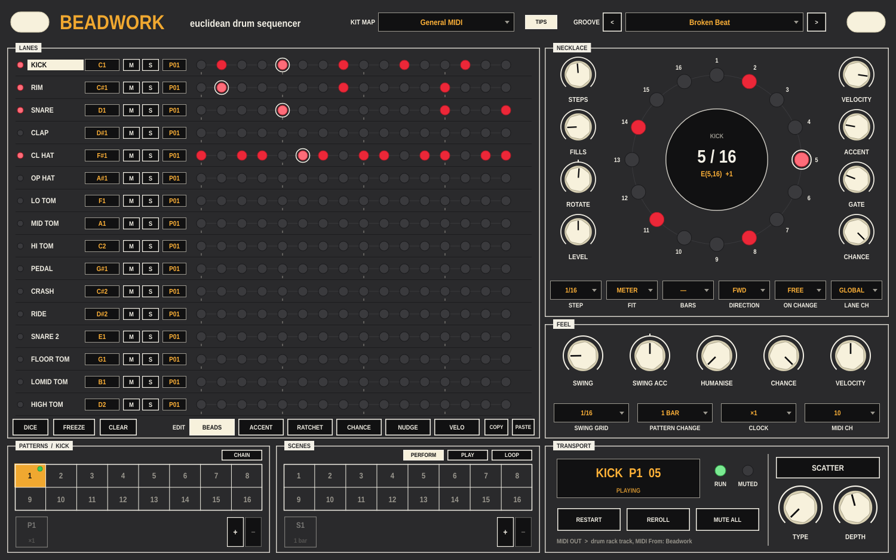

# Beadwork

A Euclidean drum sequencer, built as a VST3 MIDI generator for Ableton Live,
and as an Audio Unit MIDI effect for Logic Pro.
Sixteen lanes, one per pad of a drum rack. Each lane threads a number of beads as
evenly as possible round a necklace of steps (Bjorklund's algorithm), and you
take it from there: turn the necklace, add and remove beads by hand, accent
them, ratchet them, give them a chance of playing, nudge them early or late.
Every lane has sixteen patterns and its own chain, and sixteen scenes snapshot
the whole kit and chain together into a song. When you want to throw it about,
**SCATTER** rearranges what you hear in real time without touching the pattern.

The Euclidean engine and the pattern / sequence workflow are inspired by the
Euclid step mode of a well-known hardware sequencer, trimmed to what a drum
rack in Live actually needs.

Sibling to [Dicey](https://github.com/taddeimania/dicer): same panel language,
same "follows Live's transport" approach to the clock.



**Guides:** [Getting started](docs/Beadwork-Getting-Started.pdf) wires Beadwork to a drum kit in Live.
[Patterns, chains and scenes](docs/Beadwork-Patterns-and-Scenes.pdf) explains how the arranging layers
fit together and builds a song with them.

---

## Download

You don't need to build Beadwork yourself. Ready-made plugins for macOS,
Windows and Linux are on the [Releases page](../../releases/latest).
Download the archive for your system from the latest release:

| Archive | Contains |
|---|---|
| macOS `.zip` | `Beadwork.vst3`, universal for Apple silicon and Intel |
| Windows `.zip` | `Beadwork.vst3` |
| Linux `.tar.gz` | `Beadwork.vst3` |

Every archive also has the two PDF guides. There's no standalone version.

**Logic Pro** loads Audio Units, not VST3, so it has its own download:
**Beadwork MIDI FX**, on the releases titled *Beadwork for Logic*. See
[Using it in Logic](#using-it-in-logic).

Then install the plugin:

- **macOS**: move `Beadwork.vst3` into `~/Library/Audio/Plug-Ins/VST3`, then
  run:

  ```sh
  xattr -dr com.apple.quarantine ~/Library/Audio/Plug-Ins/VST3/Beadwork.vst3
  ```

  The builds aren't signed with an Apple developer certificate, so macOS
  quarantines them when downloaded, and the DAW refuses to load them until
  you clear that flag.
- **Windows**: copy the whole `Beadwork.vst3` folder into
  `C:\Program Files\Common Files\VST3`.
- **Linux**: copy `Beadwork.vst3` into `~/.vst3`.

Then rescan plug-ins in your DAW, and see [Using it in Live](#using-it-in-live)
for the routing.

## Building from source

Every platform needs:

- CMake 3.22 or newer
- Git
- A C++20 compiler (see each platform below)
- An internet connection for the first configure

Every build is the same three steps: configure, build, test. The first
configure downloads JUCE 8.0.9, which includes the VST3 SDK, so it takes a few
minutes; later builds are incremental.

### macOS

Install the Xcode command line tools and CMake:

```sh
xcode-select --install
brew install cmake          # or the installer from cmake.org
```

Then build:

```sh
cd path/to/beadwork
cmake -B build -DCMAKE_BUILD_TYPE=Release
cmake --build build --config Release -j
ctest --test-dir build -C Release --output-on-failure
```

The build installs `Beadwork.vst3` into `~/Library/Audio/Plug-Ins/VST3`, and
`Beadwork MIDI FX.component`, the Audio Unit for Logic, into
`~/Library/Audio/Plug-Ins/Components`. Add `-DBEADWORK_BUILD_AU=OFF` to the
configure step to build the VST3 only.

- It builds for your Mac's own processor. For a universal binary, add
  `-DCMAKE_OSX_ARCHITECTURES="arm64;x86_64"` to the configure step.
- Near the end of the build you'll see lines like *"Replacing invalid
  signature with ad-hoc signature"*. They're normal: JUCE re-signs the plugin
  after adding its metadata, and an ad-hoc signature is all you need on your
  own machine.

### Windows

You need **Visual Studio 2022** (Community is fine) with the **Desktop
development with C++** workload, which includes CMake, and **Git for
Windows**.

Open **Developer PowerShell for VS 2022**, then:

```powershell
cd path\to\beadwork
cmake -B build -G "Visual Studio 17 2022" -A x64
cmake --build build --config Release
ctest --test-dir build -C Release --output-on-failure
```

The plugin is built to `build\Beadwork_artefacts\Release\VST3\Beadwork.vst3`.
That's a folder: copy the whole folder into
`C:\Program Files\Common Files\VST3`.

To have the build copy it there for you, run the terminal as Administrator
and add `-DBEADWORK_COPY_PLUGIN=ON` to the configure step. Writing to that
folder needs administrator rights, which is why the copy is off by default on
Windows.

### Linux

Ableton Live doesn't run on Linux, but Beadwork works in any VST3 host there
that can route a plugin's MIDI output to an instrument, such as Bitwig Studio
or REAPER.

You need GCC 11+ or Clang 14+. On Debian or Ubuntu, install the toolchain and
JUCE's dependencies:

```sh
sudo apt install build-essential cmake git pkg-config \
    libasound2-dev libfreetype-dev libfontconfig1-dev libgl1-mesa-dev \
    libx11-dev libxcomposite-dev libxcursor-dev libxext-dev \
    libxinerama-dev libxrandr-dev libxrender-dev
```

On other distributions, install the equivalent `-devel` packages. Then build:

```sh
cd path/to/beadwork
cmake -B build -DCMAKE_BUILD_TYPE=Release
cmake --build build -j
ctest --test-dir build -C Release --output-on-failure
```

The build installs the plugin to `~/.vst3/Beadwork.vst3`.

### Build options

| Option | Default | What it does |
|---|---|---|
| `BEADWORK_COPY_PLUGIN` | `ON` (`OFF` on Windows) | Copy the plugin into the system VST3 folder after each build |
| `BEADWORK_JUCE_DIR` | *(empty)* | Use a local JUCE 8.0.9 checkout instead of downloading one; useful offline |
| `BEADWORK_BUILD_AU` | `ON` (macOS only) | Also build Beadwork MIDI FX, the Audio Unit for Logic Pro |
| `BEADWORK_BUILD_TOOLS` | `OFF` | Also build `BeadworkSnapshot`, a headless dev tool (see below) |
| `CMAKE_OSX_ARCHITECTURES` | your Mac's processor | `"arm64;x86_64"` builds a universal binary |

Pass any of these at configure time, for example
`cmake -B build -DBEADWORK_JUCE_DIR=/path/to/JUCE`.

### Tests

`ctest` runs `BeadworkEngineTests`. The engine has no JUCE dependency, so the
tests build and run anywhere. They cover the Euclidean figures against
Toussaint's published rhythms (tresillo, cinquillo, bossa nova clave ...), the
per-step layers, sample-accurate timing at any block size, polymeter and
polyrhythm, accents, ratchets, chance, nudge, swing, mute and solo, pattern
chains, quantised pattern changes, scene chains, transport start / stop /
jumps, a worst-case stress run, and Scatter: exact results for its types,
quantised engage, a clean return to the pattern on release, and identical
output at any buffer size for all 100 type / depth combinations.

With `-DBEADWORK_BUILD_TOOLS=ON`:

```sh
./build/BeadworkSnapshot_artefacts/Release/BeadworkSnapshot panel.png 6   # render the panel playing groove 6
./build/BeadworkSnapshot_artefacts/Release/BeadworkSnapshot --midi 2 2    # print groove 2's output as a grid
./build/BeadworkSnapshot_artefacts/Release/BeadworkSnapshot --state-test  # session round trip
./build/BeadworkSnapshot_artefacts/Release/BeadworkSnapshot --maps-test   # kit maps and grooves stay separate
```

### Continuous integration

[`.github/workflows/build.yml`](.github/workflows/build.yml) runs the same
configure, build and test steps on macOS (universal), Windows (x64) and Linux
(x64). It only runs when you start it: on GitHub, open **Actions** →
**Build** → **Run workflow**, and choose a branch or tag under **Use workflow
from**.

A run on a branch uploads the packaged plugins as artifacts, kept for 30 days.
Those are development builds; the downloads for players are on the
[Releases page](../../releases/latest).

[`.github/workflows/build-logic.yml`](.github/workflows/build-logic.yml) builds
the Logic Audio Unit on macOS (universal), runs the engine tests, and checks
the component with Apple's `auval`, the same validation Logic runs before it
lists a plug-in. Start it the same way: **Actions** → **Build (Logic AU)** →
**Run workflow**.

### Making a release

1. Set the version in `CMakeLists.txt`, for example
   `project(Beadwork VERSION 1.0.0 ...)`.
2. Write the release text in
   [`.github/release-notes.md`](.github/release-notes.md).
3. Commit both, then tag and push:

   ```sh
   git tag -a v1.0.0 -m "Beadwork 1.0.0"
   git push origin main v1.0.0
   ```

4. On GitHub, run the **Build** workflow and pick the `v1.0.0` tag under
   **Use workflow from**.

A run on a tag builds all three platforms and creates a **draft** release
with the archives and release notes attached. Review it on the Releases page
and press **Publish**. A tag that doesn't match the version in
`CMakeLists.txt` stops the build, so the downloads can't be labelled with the
wrong version.

The Logic Audio Unit is released separately, with its own tag and notes:

1. Write the release text in
   [`.github/release-notes-logic.md`](.github/release-notes-logic.md).
2. Tag the same commit with `logic-v` and the version, and push the tag:

   ```sh
   git tag -a logic-v1.2.0 -m "Beadwork for Logic 1.2.0"
   git push origin logic-v1.2.0
   ```

3. Run the **Build (Logic AU)** workflow and pick the `logic-v1.2.0` tag.

That creates a draft release titled *Beadwork for Logic 1.2.0* with the
component zip attached. It isn't marked as the latest release, so the VST3
release stays at the top of the Releases page.

---

## Using it in Live

Beadwork makes MIDI, not sound.

1. Put Beadwork on a MIDI track.
2. Put your drum rack (a 909 kit, say) on a second MIDI track.
3. On the drum rack's track, set **MIDI From** to the Beadwork track, choose
   **Beadwork** in the second dropdown, and set **Monitor** to **In**.
4. Press play in Live.

Lanes default to the General MIDI drum notes, which is where Live's drum racks
put their pads: kick C1, rim C#1, snare D1, clap D#1, closed hat F#1, open hat
A#1, and so on. Click a lane's note to change it, and double-click its name to
relabel it. Beadwork sends on channel 10 by default; each lane can have its own
channel. Once the lanes match your rack, save them as a **kit map** (see
[Kit maps and grooves](#kit-maps-and-grooves)) so you only do this once per rack.

Incoming MIDI passes straight through, so you can still play the rack from a
keyboard on Beadwork's track.

---

## Using it in Logic

Beadwork MIDI FX goes in the **MIDI FX** slot of a Software Instrument track,
in front of Drum Machine Designer, Drum Kit Designer or any drum instrument.

1. Install `Beadwork MIDI FX.component` into
   `~/Library/Audio/Plug-Ins/Components` and clear the quarantine flag:

   ```sh
   xattr -dr com.apple.quarantine ~/Library/Audio/Plug-Ins/Components/"Beadwork MIDI FX.component"
   ```

2. Open Logic. If Beadwork isn't listed, open **Logic Pro → Settings →
   Plug-in Manager**, select it and click **Reset & Rescan Selection**.
3. On a drum track, click the **MIDI FX** slot and choose **Audio Units →
   Taddei → Beadwork MIDI FX**.
4. Press play. Beadwork follows Logic's transport.

For Drum Kit Designer pick the **General MIDI** kit map. Drum Machine
Designer's pads run up from C1, so pick **Chromatic C1-D#2** and label the
lanes. Then save a kit map for that kit. Grooves and kit maps are shared with
the VST3, so a groove saved in Live loads in Logic.

Logic records what arrives at a track, not what leaves its MIDI FX slot. To
capture Beadwork's notes as a region, put **Record MIDI to Track Here** in the
MIDI FX slot below Beadwork, then on a second instrument track set **Internal
MIDI In** to that track and record there. `docs/Beadwork-in-Logic.txt`, which
also comes in the download, has the steps.

---

## The panel

### Lanes

Sixteen rows, one per lane: a gate LED that blinks on every hit, the name
(double-click to rename), the MIDI note, **M**ute, **S**olo, the pattern on
screen, and the beads. Click a row to focus it in the necklace.

Sets, grooves and kit maps saved by 1.2.0 and earlier, which had twelve
lanes, load into lanes 1 to 12; lanes 13 to 16 start empty on their default
notes.

Mute is a gate, not a stop: a muted lane keeps its place and comes back in
time.

The **EDIT** buttons choose what a click or drag on a bead does:

| Layer | Click | Drag up / down |
| --- | --- | --- |
| BEADS | add or remove a bead (drag across to paint) | |
| ACCENT | accent a bead: velocity + ACCENT (drag to paint) | |
| RATCHET | cycle 1, 2, 3, 4, 6, 8 hits in the step | 1 to 8 hits |
| CHANCE | toggle 50 % / 100 % | 1 to 100 % |
| NUDGE | centre it | up to half a step early or late |
| VELO | follow the pattern's velocity | the bead's own velocity |

Edits sit on top of the Euclidean figure, so you can keep turning FILLS and
ROTATE and your edits stay put. **FREEZE** bakes the current figure into
hand-placed beads. **CLEAR** empties the pattern on screen (no beads, no
edits); **shift-click CLEAR** wipes only your edits and keeps the figure.
**DICE** rolls a new figure. **COPY** / **PASTE** move a whole pattern.

### Necklace

The focused lane's pattern as a ring of LEDs, step 1 at the top. Drag the
centre round to **rotate** the necklace, scroll the centre for **fills**,
shift-scroll for **steps**. Step numbers turn amber where you've edited the
figure.

| Control | Range | What it does |
| --- | --- | --- |
| STEPS | 1 - 32 | slots on the necklace |
| FILLS | 0 - steps | beads, spread as evenly as possible |
| ROTATE | -31 - 31 | turn the necklace; positive moves beads later |
| LEVEL | 0 - 200 % | the lane's level (automatable) |
| VELOCITY | 1 - 127 | an ordinary bead |
| ACCENT | 0 - 127 | added on accented beads |
| GATE | 1 - 200 % | note length, as a share of the step |
| CHANCE | 0 - 100 % | the chance each bead plays; per-step chance multiplies with it |
| STEP | 1/4 - 1/32T | step length |
| FIT | METER / RHYTHM | see below |
| BARS | 1 - 16 | in RHYTHM fit, the bars the steps are squeezed into |
| DIRECTION | FWD, REV, PEND, RAND | which way the playhead walks |
| ON CHANGE | FREE, RELATCH, ONCE | what the lane does when its pattern changes |
| LANE CH | GLOBAL, 1 - 16 | MIDI channel |

**FIT** decides what happens when lanes have different numbers of steps:

- **METER** (polymeter): a step is a fixed note value. A 7-step lane and a
  16-step lane drift against each other and line up again every 112 steps.
- **RHYTHM** (polyrhythm): the steps are squeezed into BARS bars, so every lane
  comes round together. Five steps in a bar against a four-on-the-floor kick is
  a 5:4 polyrhythm.

**ON CHANGE**: FREE keeps the playhead's place in the loop, RELATCH restarts
the loop from step 1, ONCE plays the new pattern once and then waits silently
for the next change.

### Feel

Global, automatable.

| Control | What it does |
| --- | --- |
| SWING | 50 - 99 %: delays every second slot of the swing grid. 50 % is straight |
| SWING ACC | accent the first (left of centre) or second (right) of each swung pair |
| HUMANISE | random timing spread |
| CHANCE | scales the chance of every bead on every lane; ride it for breakdowns |
| VELOCITY | scales every velocity |
| SWING GRID | 1/8, 1/16 or 1/32 |
| PATTERN CHANGE | when a newly picked pattern takes over: at once, next step, beat, 1 / 2 / 4 / 8 bars, or end of the loop |
| CLOCK | x2, x1, /2, /4, /8 against Live |
| MIDI CH | the default channel |

The random parts (chance, humanise, RAND direction) are deterministic: the same
dice every time round, so a groove you like stays the groove you like.
**REROLL** throws new dice.

### Patterns

The focused lane's sixteen patterns. Click a pattern to play and edit it; the
switch waits for PATTERN CHANGE. Shift-click adds a pattern to the lane's chain.
Right-click to copy, paste, clear, copy to every slot, or add to the chain.
**Copy all lanes** grabs that slot from all sixteen lanes at once (the whole
kit's pattern 3, say) and **Paste all lanes** drops them into another slot, so
you can start a new kit-wide pattern from an existing one.

**CHAIN** turns the lane's chain on. Each slot plays its pattern N times, then
moves on, and the chain loops. Drag a slot's top half to change its pattern,
its bottom half to change the repeats; click a slot for insert / delete. **+**
adds the highlighted pattern (the amber pad) to the end of the chain, and **-**
removes the last slot, so a quick way to build a chain is: click a pad, press
**+**, click the next, press **+**.

While a chain plays, the lane shows the pattern that's playing. Click any of
the lane's pads to look at and edit that one instead (and to pick it for **+**);
the lane goes back to following the chain the next time you press play, or
when you turn CHAIN on.

Each lane's pattern is also a host parameter (**Lane N Pattern**), so you can
automate pattern changes in Live's arrangement.

### Scenes

A scene stores every lane's pattern and mute. Click an empty pad to store the
current kit into it, click a stored one to recall it, shift-click to
overwrite. Right-click a scene for:

- **Save all lanes to scene**: stores every lane's pattern and mute (the same
  as shift-click).
- **Update current lane in scene**: changes just the focused lane's pattern
  and mute in that scene, leaving the other eleven as they were. Handy for
  swapping the hats in CHORUS without touching anything else.
- **Rename**, **Clear**, and **Add to the scene chain**.

Scene pads light like pattern pads: **amber** is the scene you last recalled or
stored, and the **green light** means the kit is playing exactly that scene.
Recall one mid-bar and it turns amber at once; the green light comes on at the
bar line when its patterns land, and goes out if you then change a lane's
pattern or mute. While the scene chain runs, both follow the chain.

| Mode | What it does |
| --- | --- |
| PERFORM | scenes change only when you click them |
| PLAY | play the scene chain once from the song's start, then hold the last scene |
| LOOP | loop the scene chain for as long as Live plays |

Each scene-chain slot has a scene and a length in bars. While the scene chain
runs it chooses each lane's pattern and mute; a lane's own chain still wins
over it.

### Transport

The LCD shows the focused lane, its playing pattern and step, and the scene
chain's position (or the Scatter type and depth while it's on). **RESTART**
brings every lane and chain back to the top on the next beat. **REROLL** throws
new dice. **MUTE ALL** silences everything while it keeps running underneath.

### Scatter

A performance effect after the one on Roland's TR-8 and TR-8S. While it's on,
what you hear is the loop's steps rearranged on a 1/16 grid: swapped, reversed,
repeated, slowed, chopped. The sequencer keeps walking underneath, so when you
let go you drop straight back to where the pattern would have been. Nothing
stored changes.

- **Tap SCATTER** to latch it on; tap again to turn it off.
- **Hold SCATTER** for a throw: it stops when you let go.
- It always starts on the next 1/16, so a throw is never off the grid, and it
  scatters every lane together.
- **Scatter**, **Scatter Type** and **Scatter Depth** are host parameters, so
  you can draw throws into an arrangement.

| Type | What it does | What DEPTH changes |
| --- | --- | --- |
| 1 STUTTER | each group of steps repeats its first step | group size: 2, 4, 8, 16 steps |
| 2 REVERSE | the window plays back to front | window: a beat, half a bar, a bar |
| 3 HALF | the first half of the window at half speed | window |
| 4 DOUBLE | the window twice over at double speed | window |
| 5 SKIP | jumps ahead, dropping steps | from 1 step in 10 to every other step |
| 6 SWAP | neighbouring steps trade places | how many pairs swap |
| 7 ROLL | the end of each bar rolls the step before it, building up | how long the roll is (1 to 8 steps) |
| 8 TAPE STOP | the end of each bar slows to a halt | how early the slowdown starts |
| 9 GATE | a rhythmic chop that silences parts of the bar (never the downbeat) | how much of the bar is cut |
| 10 SCRAMBLE | steps drawn from anywhere in the bar, a new draw each bar for four bars | how many steps move |

Each type and depth always does the same thing, the way a preset on hardware
does, so a throw you like is a throw you can repeat. The ten types are
Beadwork's own: the TR-8S manual doesn't document what its types do, only that
Scatter exchanges steps and changes playback direction and gate length.

### Kit maps and grooves

Beadwork saves two things separately, each with its own display in the header:

- **KIT MAP** is the wiring: each lane's label, MIDI note and channel. Save one
  per drum rack ("909 Core Kit", "My Linn rack") and pick it whenever you use
  that rack.
- **GROOVE** is everything else: the beads and hand edits, all sixteen patterns
  per lane, the chains, the scenes, and the feel knobs.

Changing the groove never touches the kit map, and changing the kit map never
touches the groove, so any groove plays on any rack. A `*` after the map's
name means you've changed a note, label or channel since loading it; open the
KIT MAP menu and choose **Save** (or **Save as...**) to keep the change.

Your saves live in `~/Library/Application Support/Beadwork/` (`%APPDATA%\Beadwork`
on Windows, `~/.config/Beadwork` on Linux): kit maps in `Kit Maps/` as
`.beadmap` files, grooves in `Grooves/` as `.beadwork` files. Kits saved by
1.1.0 and earlier (in `Presets/`) are copied into `Grooves/` the first time
you run this version. They load as grooves, which means their old notes and
labels are left out.

Factory kit maps:

- **General MIDI**: Kick, Rim, Snare, Clap, hats, toms, Pedal, Crash, Ride and
  a second snare on the General MIDI drum notes, which is where Live's own kits
  put them. The sixteen lanes cover all sixteen pads of a standard Drum Rack,
  C1 to D#2.
- **Chromatic C1-D#2** and **Chromatic C2-D#3**: sixteen pads in a row, labelled
  with their notes.

Factory grooves:

- **Empty** starts from nothing: not a bead anywhere.
- **Init Groove** is a simple groove on kick, rim, snare and hats.
- **Four To The Floor, Tresillo, Bossa Clave, Polymeter Study, Quintuplets,
  Broken Beat, Chain Demo** are worked examples. They're written for the
  General MIDI lane order (lane 1 kick, lane 3 snare, lane 5 closed hat), so
  they make most sense with a map in that order.

### Tooltips

Hover over any control for a short explanation. The **TIPS** button at the
top turns them off (or back on). It's remembered for every Beadwork in every
set, in `~/Library/Application Support/Beadwork/Beadwork.settings`
(`%APPDATA%\Beadwork` on Windows, `~/.config/Beadwork` on Linux). The value
bubbles that show while you turn a knob stay either way.

---

## License

AGPLv3. See [LICENSE](LICENSE).
